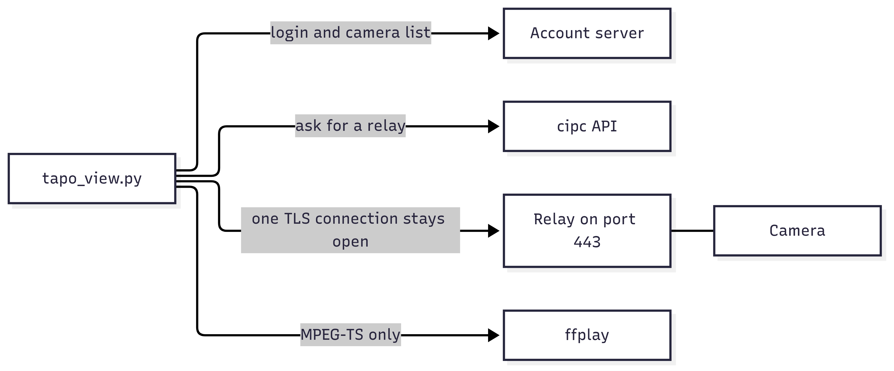
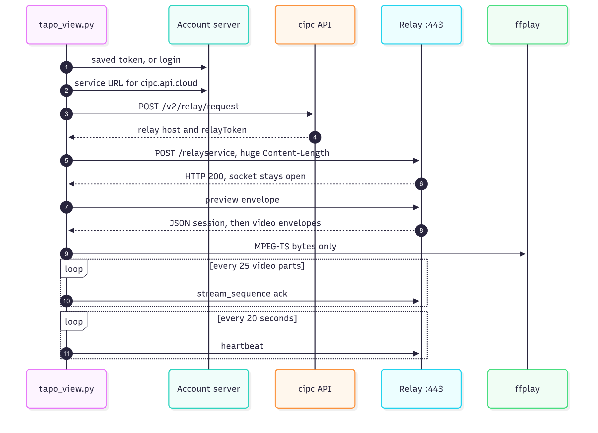
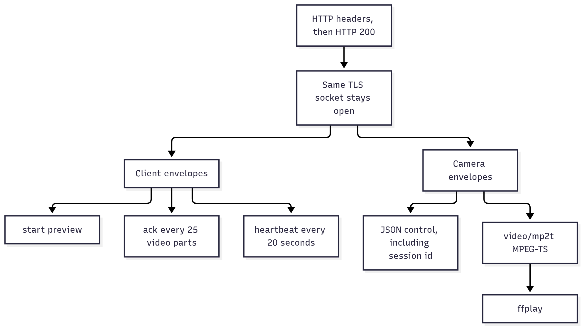

# Tapo cloud live view

> Generated by Grok 4.7 using the original Android TP-Link Tapo (com.tplink.iot) apk.

`tapo_view.py` logs into your TP-Link account and plays a camera through the same cloud relay the Tapo app uses. It works when you are away from the camera's network.

You need Python 3, the `requests` package, and `ffplay` (from ffmpeg). The script trusts the system CAs plus the TP-Link Cloud Root CA, which is included in the file because the relay hosts are signed by that private root.



## Sign in and list cameras

```sh
export TAPO_EMAIL=you@example.com
python3 tapo_view.py list
```

The password is asked with a hidden prompt. Leave it off the command line so it does not land in shell history. If the account has two-step verification, a code is sent to a signed-in Tapo app, or by email if that notification cannot be sent, and the script asks for it.

A successful login is stored in `~/.config/tapo-cli/session.json` (mode 0600). Later `list`, `play`, and `ptz` commands print `using saved session` and do not ask again until the server rejects the token.

`list` prints a header, then one camera per line:

```text
deviceId    model    alias
```

`--detailed` asks each camera whether it can pan and tilt, and adds a `ptz` column (`yes` or `no`). That is a separate call per camera, so plain `list` stays as it is.

```sh
python3 tapo_view.py list --detailed
```

## Play

One camera on the account:

```sh
python3 tapo_view.py play
```

Several cameras, match the alias:

```sh
python3 tapo_view.py play --name kitchen
```

Or pass the id from `list`:

```sh
python3 tapo_view.py play --id DEVICE_ID
```

`play` opens `ffplay` on the live MPEG-TS stream. Stop it with Ctrl+C in the terminal.

`--resolution` is `HD` (the default) or `VGA`.

`--audio` also plays the microphone, when the camera reports audio support. The track in the relay is G.711 inside a private MPEG-TS type, so ffplay cannot play it from the video pipe. The script lifts that track out and plays it beside the picture. A camera with the microphone muted, or with its volume at 0, stays silent.

```sh
python3 tapo_view.py play --name kitchen --audio
```

`--rewrite-sei` rewrites the camera's private H.264 SEI into filler before the bytes reach ffplay or `--stdout`. Some cameras put a short SEI in every frame, and ffplay then logs `SEI type … truncated` once per frame. The picture does not use that SEI. Without the flag the stream is left as the camera sent it.

```sh
python3 tapo_view.py play --name kitchen --rewrite-sei
```

To feed another player, write the stream to stdout:

```sh
python3 tapo_view.py play --name kitchen --stdout \
  | ffplay -fflags nobuffer -flags low_delay -f mpegts -i pipe:0
```

## Pan and tilt

`ptz` asks the camera for its component list first. A camera without `ptz` is left alone. The C210 and C200 on a typical account can pan and tilt; a fixed camera such as the C120 cannot.

```sh
python3 tapo_view.py ptz left --name kitchen
python3 tapo_view.py ptz right --step 20
python3 tapo_view.py ptz up
python3 tapo_view.py ptz down
python3 tapo_view.py ptz stop
```

`left`, `right`, `up`, and `down` send one relative `motorMove`. Positive x is right and positive y is up. `--step` is that distance (default 10). `stop` sends `stopMove`.

Presets:

```sh
python3 tapo_view.py ptz presets --name kitchen
python3 tapo_view.py ptz goto 1 --name kitchen
```

`presets` prints `id` and `name`. `goto` moves to that id.

A patrol sweeps one axis until you stop it. `x` pans and `y` tilts:

```sh
python3 tapo_view.py ptz cruise x --name kitchen
python3 tapo_view.py ptz cruise-stop --name kitchen
```

## Relay session

There is no public stream URL. `play` builds a short-lived session the same way the Tapo app does, then pulls MPEG-TS off that socket.



1. The account server is asked for the `cipc.api.cloud` service URL.
2. `POST {cipc}/v2/relay/request` names the camera (`deviceId`), this client (`playerId`, also sent as `X-Client-Id`), and the picture size. `streamType` 0 is a live preview, `cloudType` 2 is the IoT cloud. The reply is a relay host plus a one-time `relayToken`. The host looks like `euw1-relay-….dcipc.i.tplinkcloud.com` and the path is `/relayservice?…`.
3. The script opens TLS to that host on port 443 and sends one HTTP POST that stays open. `Content-Length` is the largest 64-bit value, so the connection is a stream rather than a request with a body of known size. `X-token` is the relay token. `X-Pull-Mode: 2` asks the relay to forward the camera directly.
4. Both sides then write multipart parts on that same socket. Client parts use the boundary `----client-stream-boundary--`. The camera uses `----device-stream-boundary--`. Each part is a header block, a blank line, and a body whose size is `Content-Length`.



The first client part is the preview request, with `X-Data-Window-Size: 50`:

```json
{"type":"request","seq":1,"params":{"method":"get","preview":{"channels":[0],"resolutions":["HD"],"audio":["default"]}}}
```

The camera answers with a JSON part. A successful one looks like `{"type":"response","seq":1,"params":{"error_code":0,"session_id":"171"}}`. Later JSON parts are control messages and are printed on stderr.

Video parts are `Content-Type: video/mp2t`. The body is ordinary MPEG-TS: 188-byte packets, H.264 on video PID `0x44`, and the microphone on the next PID as G.711 with a private stream type (`0x90`) that ffplay does not decode. The camera's timestamps start far from zero (tens of thousands of seconds), so `ffplay` is told to sync to the video. `--audio` reads the microphone codec from the camera and plays that G.711 track on its own. Each video part also carries `X-Data-Sequence`. Every 25th part the script sends a `stream_sequence` notification with `X-Data-Received` and `X-Session-Id`, which is how the camera knows the client is still taking data. A heartbeat JSON part goes out every 20 seconds.

`ffplay` is given a 32 KiB probe and no analyze delay so the window opens on the first frames. `--stdout` skips `ffplay` and writes those same MPEG-TS bytes to stdout.

## Options

| Option | Meaning |
| --- | --- |
| `--email` | Account email. Defaults to `TAPO_EMAIL`. Remembered with the session. |
| `--password` | Password. Omit it to be prompted. Skipped while the saved session is valid. |
| `--mfa CODE` | Two-step code. Omit it to be prompted after the code is sent. |
| `--name TEXT` | Camera alias substring. |
| `--id DEVICE_ID` | Camera id from `list`. |
| `--resolution HD\|VGA` | Stream size. Default `HD`. |
| `--step N` | Pan/tilt distance for `ptz` left, right, up, and down. Default 10. |
| `--detailed` | With `list`, add `yes` or `no` for pan and tilt. |
| `--audio` | With `play`, play the microphone when the camera supports it. |
| `--rewrite-sei` | With `play`, rewrite the private H.264 SEI so ffplay stays quiet. |
| `--stdout` | MPEG-TS on stdout instead of launching `ffplay`. |
